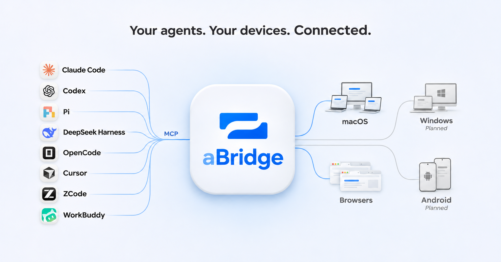
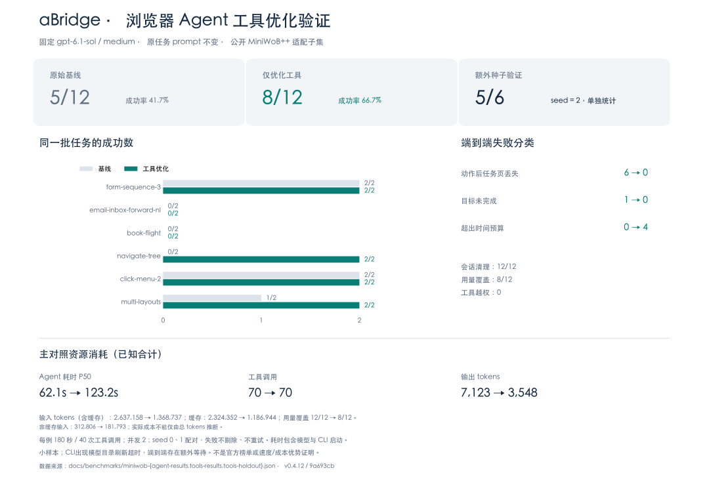

# aBridge

**通过 MCP，让云端 Agent 使用用户授权的电脑和浏览器，复用本机应用、网站登录态与工作环境。**

[快速开始](#快速开始) · [Yuxi 集成](#与-yuxi-一起使用) · [下载](https://github.com/xerrors/aBridge/releases) · [Agent Benchmark](#agent-benchmark) · [文档](#文档)

## 解决什么问题

云端 Agent 可以推理和调用工具，却通常无法直接访问用户电脑上的应用、文件，以及已经登录的浏览器 Profile。aBridge 将这些设备能力接入 MCP，让 Agent 在用户授权的范围内完成工作：

- **操作 OA 与业务系统**：使用浏览器现有登录态，查找信息、填写表单、执行网页操作。
- **处理本地工作**：查看应用和窗口、操作桌面、运行 Shell、读写文件。
- **连接多台设备**：同一账户管理多台电脑与多个浏览器 Profile，按 Agent 分配设备和能力。

## 工作方式


Server 提供 MCP 接口、账户管理和授权控制。App 与浏览器扩展**独立安装、独立授权、直接连接 Server**；浏览器操作不依赖 App，也不经 App 转发。

| 客户端                  | 能力                                       | 当前支持                   |
| ----------------------- | ------------------------------------------ | -------------------------- |
| **aBridge App**         | 屏幕观察、键鼠操作、Shell、UTF-8 文件读写  | Apple Silicon，macOS 14+   |
| **aBridge for Browser** | 网页观察、导航、点击、填表与浏览器代码执行 | Chromium 扩展，Chrome 116+ |

浏览器扩展复用当前 Profile 的登录态，并为任务创建独立标签页。每个 Profile 注册为独立设备；浏览器退出后设备离线，扩展不能自行启动浏览器。Windows 与 Android 原生客户端仍在规划中。

## 快速开始

独立使用按以下四步完成：**部署 Server → 创建账户 → 连接设备 → 配置 Agent**。已有 Yuxi 的用户可先看 [Yuxi 集成](#与-yuxi-一起使用)。

### 1. 部署 Server

推荐使用 Docker。下面的示例供本机使用，数据保存在持久卷中：

```sh
docker run -d --name abridge --restart unless-stopped \
  -p 127.0.0.1:8765:8765 \
  -v abridge-data:/data \
  -e ABRIDGE_PUBLIC_ORIGIN=http://127.0.0.1:8765 \
  ghcr.io/xerrors/abridge:0.4.12
```

打开 [http://127.0.0.1:8765](http://127.0.0.1:8765)。镜像支持 Linux amd64 / arm64，仅包含 Server 和管理台，无需在服务器安装桌面驱动或浏览器。

跨机器使用时，客户端必须能访问 Server。请配置对外的 `ABRIDGE_PUBLIC_ORIGIN`、端口映射及 HTTPS/WSS 反向代理；更新容器时复用数据卷。详见 [Docker 部署](docs/deployment.md#docker-镜像)。

<details>
<summary>不使用 Docker：通过 Node.js 运行</summary>

需要 Node.js 22.x（最低 22.13.0）、23.x（最低 23.4.0）或 24 以上版本，以及 npm。公开 npm 包尚未发布，使用 GitHub Release 中的实际 tarball：

```sh
npx --yes \
  --package=https://github.com/xerrors/aBridge/releases/download/v0.4.12/xerrors-abridge-0.4.12.tgz \
  abridge --web
```

默认监听 `127.0.0.1:8765`，`--web` 打开本机管理员链接；状态保存在系统用户数据目录，可用 `--data-dir` 指定持久目录。运行环境、源码安装和无图形环境配置见 [安装与维护](docs/deployment.md)。

</details>

### 2. 创建账户

首次启动会生成实例管理员 Token。使用上面的 Docker 示例时，在本机终端获取管理员链接：

```sh
docker exec abridge node -e '
const fs = require("node:fs");
const token = fs.readFileSync("/data/server.db.admin-token", "utf8").trim();
console.log(process.env.ABRIDGE_PUBLIC_ORIGIN + "/#admin_token=" + encodeURIComponent(token));
'
```

该链接包含管理员凭据，请勿分享。打开链接，在“实例管理”中创建普通账户，再以普通账户登录管理台，管理自己的设备和 Agent 连接。**实例管理员身份不代替普通账户，也不授予设备操作权限。**

### 3. 连接设备

按需安装一种或两种客户端，填写客户端可以访问的 Server 地址，在浏览器中登录普通账户并确认授权：

| 客户端         | 安装与连接                                                                                                                                                               |
| -------------- | ------------------------------------------------------------------------------------------------------------------------------------------------------------------------ |
| **浏览器扩展** | 从 [Chrome 应用商店](https://chromewebstore.google.com/detail/abridge-for-browser/jbkhngckehhhhkbgpjlifbbchhbeodjc) 安装，点击扩展图标填写 Server 地址，完成浏览器授权。 |
| **macOS App**  | 从 [GitHub Releases](https://github.com/xerrors/aBridge/releases) 下载 Apple Silicon 包，填写 Server 地址并完成授权，启用所需能力。                                      |

屏幕与键鼠操作还需为实际安装的 App 授予录屏和辅助功能权限。当前 macOS 下载包为 ad hoc 签名、未公证；安装说明见 [macOS App](docs/deployment.md#macos-app)。扩展源码加载方式见 [浏览器客户端](docs/browser-profile-design.md)。

### 4. 配置 Agent

在管理台创建 **Agent 连接**，选择允许访问的设备、能力与有效期。将生成的 **Agent Key** 配入支持 Streamable HTTP 的 MCP 客户端；Codex、OpenCode、ZCode 等客户端的具体配置入口以各自文档为准。

以下是 MCP 连接参数；不同客户端的外层配置格式可能不同：

```json
{
  "url": "http://127.0.0.1:8765/mcp",
  "headers": { "Authorization": "Bearer <AGENT_KEY>" }
}
```

云端 Agent 需将示例地址换成它可以访问的 Server 地址。连接后按 `devices_list` → `session_open` → 工具操作 → `session_close` 使用。

## 与 Yuxi 一起使用

aBridge 可以与 [Yuxi](https://github.com/xerrors/Yuxi) 一起部署，复用 Yuxi 的账户体系；通过 Yuxi 的对外入口及容器内部网络集成，无需为 aBridge 单独开放公网端口。设备仍连接到部署中为 aBridge 配置的可达地址。

两种接入路径的区别：

| 路径          | 账户登录           | MCP 调用认证                               |
| ------------- | ------------------ | ------------------------------------------ |
| **独立使用**  | 管理员创建本地账户 | 管理台生成的 Agent Key                     |
| **Yuxi 集成** | OIDC 单点登录      | 显式启用平台委托后，由平台签发短期委托令牌 |

OIDC 登录本身不授予 MCP 调用权限，浏览器 ID Token 也不能直接作为 MCP 访问令牌。平台连接仍受用户设备授权、本机开关与系统权限限制。部署参数、回调地址及容器内认证请求配置见 [OIDC 登录与平台 MCP 委托](docs/deployment.md#可选-oidc-登录与平台-mcp-委托)。

## Agent Benchmark

<!-- benchmark:miniwob:start -->

真实 **gpt-6.1-sol（medium）Agent** 通过 aBridge 完成公开 MiniWoB++ 任务：**8/12（66.7%）**。任务、种子和预算在跑分前冻结，无重试，全部结果保留。

通用工具修复前 **5/12** → 修复后 **8/12**；模型、任务 prompt、seed 0/1 和预算不变。另用额外 seed=2 验证：**5/6**，单独统计。标准审核剔除 **0** 例。



| 任务                     | 修复前 | 修复后 | Agent P50（秒） | 工具调用总数 | 已知输入 / 输出 tokens | 用量覆盖 |
| ------------------------ | ------ | ------ | --------------- | ------------ | ---------------------- | -------- |
| `form-sequence-3`        | 2/2    | 2/2    | 126.9           | 12           | 440540 / 1153          | 2/2      |
| `email-inbox-forward-nl` | 0/2    | 0/2    | 180.0           | 13           | 0 / 0                  | 0/2      |
| `book-flight`            | 0/2    | 0/2    | 180.0           | 23           | 0 / 0                  | 0/2      |
| `navigate-tree`          | 0/2    | 2/2    | 79.1            | 4            | 218212 / 533           | 2/2      |
| `click-menu-2`           | 2/2    | 2/2    | 115.5           | 8            | 328526 / 812           | 2/2      |
| `multi-layouts`          | 1/2    | 2/2    | 107.3           | 10           | 381459 / 1050          | 2/2      |

每例限 180 秒 / 40 次工具调用，并发 2；仅开放观察、读取、操作、等待，支持 DOM 与截图，不开放 JS 执行、源码直接读取或判分接口。P50 包含 CLI 启动和模型调用，已启动的失败也计时。表中 token 为已知样本合计（输入含缓存），超时未返回用量视为未知，不能按 0 计费；CLI 不提供实际美元账单。

失败分类：time_budget × 4。用量覆盖 8/12；会话清理 12/12。

最终运行的 CLI 日志出现模型目录刷新超时，端到端耗时受工具之外等待影响；失败全部保留，不能据此宣称稳定速度或成本优势。详见工具修复报告。

测量快照：v0.4.12 / 9a693cb。环境：Apple M4 / darwin arm64 / Chrome/153.0.8010.12 / Node v22.23.5 / codex-cli 0.166.0；记录时间 2026-11-17T05:48:34.531Z。

这是 **6 类任务、每类 2 个种子的小样本适配子集**，原始任务限时统一延长至 180 秒，不是官方榜单成绩；单次前后对照仍有模型随机性，也不能单独证明 aBridge 优于其他工具或覆盖 macOS App。固定策略的 30/30 仅作为执行链冒烟历史数据，与 Agent 分数分开。[方法与限制](docs/benchmarks/miniwob.md) · [工具修复报告](docs/benchmarks/browser-reliability.md) · [全量报告](docs/benchmarks/cases-all.md) · [标准审核报告](docs/benchmarks/cases-conforming.md) · [逐次实测数据](docs/benchmarks/miniwob-tools-results.json)。

```sh
npm run benchmark:miniwob
```

<!-- benchmark:miniwob:end -->

## 授权与安全边界

- **设备与能力显式授权**：每个 Agent 连接可选择设备、能力和有效期；设备本机可以暂停或关闭能力，自动重连不会解除这些限制。
- **凭据各司其职**：Admin Token 用于实例管理，Device Key 用于设备连接，Agent Key 用于 MCP 调用，三者不能互换。
- **沿用用户的执行环境**：浏览器脚本具有当前站点登录用户的页面权限；Shell 与文件工具在已授权设备上执行。请按任务分配所需能力。
- **未知操作不盲目重放**：断连或超时可能发生在副作用之后；应查询原操作状态、重新观察，再决定下一步。撤销权限不能回滚已执行的操作。

## 文档

| 文档                                           | 内容                                             |
| ---------------------------------------------- | ------------------------------------------------ |
| [安装与维护](docs/deployment.md)               | Docker、Node.js、App、反向代理、升级与 OIDC 配置 |
| [架构与执行契约](docs/architecture.md)         | 模块职责、工具接口、会话、去重、取消与结果语义   |
| [浏览器客户端](docs/browser-profile-design.md) | Profile 授权、任务标签、网页工具及浏览器代码接口 |
| [Server API](apps/server/README.md)            | 管理员接口、Server 运行方式与分发说明            |
| [贡献指南](.github/CONTRIBUTING.md)            | 开发环境、检查命令与提交规范                     |

[下载发布产物](https://github.com/xerrors/aBridge/releases) · [报告问题](https://github.com/xerrors/aBridge/issues) · [Apache-2.0 许可证](LICENSE)
