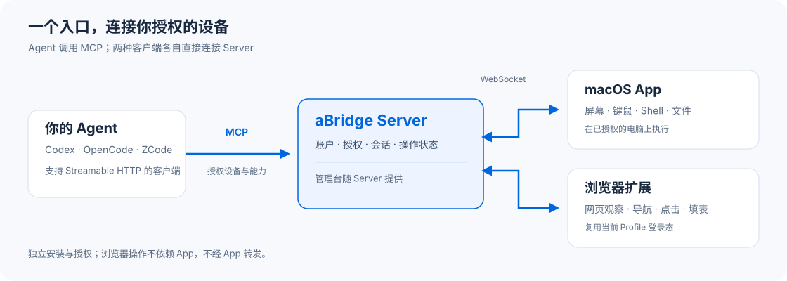

# aBridge

**自托管的 MCP 服务，让 Agent 在你授权的设备和浏览器中执行任务。**

[快速开始](#快速开始) · [选择客户端](#选择客户端) · [评测与验证](#评测与验证) · [Yuxi 集成](#与-yuxi-一起使用) · [开发与文档](#开发与文档) · [下载](https://github.com/xerrors/aBridge/releases/latest)

aBridge 由 Server 和按需安装的客户端组成。Server 提供统一的 MCP 入口和授权管理，客户端在对应设备或 Chrome Profile 上执行操作。你可以为每个 Agent 单独指定设备、能力和有效期。

## 选择客户端

| 想完成的任务                           | 客户端                                                           | 环境                     |
| -------------------------------------- | ---------------------------------------------------------------- | ------------------------ |
| 在已登录的业务系统里查资料、填表       | **浏览器扩展** · 观察、导航和操作网页，复用所选 Profile 的登录态 | Chrome 116+              |
| 查看桌面窗口、操作原生应用或处理文件   | **macOS App** · 屏幕、键鼠、Shell、UTF-8 文件                    | Apple Silicon，macOS 14+ |
| 在开发机或服务器上执行 Shell、读写文件 | **Linux CLI** · Shell、UTF-8 文件，支持 systemd 后台运行         | Linux amd64 / arm64      |
| 操作 Android 应用、读写授权目录        | **Android 预览** · 屏幕、点按、滑动、文本输入和目录读写          | Android 13+，从源码构建  |

## 工作方式



各客户端独立安装、授权并直接连接 Server。桌面和浏览器可以分别接入。一个 Chrome Profile 对应一个浏览器设备，扩展在该 Profile 内为任务创建独立标签页。

## 快速开始

准备一个支持 Streamable HTTP 的 MCP 客户端，按以下步骤部署 Server 并让 Agent 列出第一台设备。已有 Yuxi 的用户可先看 [Yuxi 集成](#与-yuxi-一起使用)。

### 1. 部署 Server

最新正式 [GitHub Release 为 0.4.18](https://github.com/xerrors/aBridge/releases/tag/v0.4.18)。Server 通过 Release 的 tarball 运行，需要 npm 和 Node.js 22.x（22.13 起）、23.x（23.4 起）或 24 及以上版本：

```sh
npm exec --yes \
  --package=https://github.com/xerrors/aBridge/releases/download/v0.4.18/xerrors-abridge-0.4.18.tgz \
  -- abridge --web
```

默认监听 [127.0.0.1:8765](http://127.0.0.1:8765)。`--web` 在本机打开实例管理页面，可通过 `--data-dir` 指定持久目录。

<details>
<summary>使用 Docker</summary>

下面使用已发布的 **0.4.17** 镜像，支持 Linux amd64 和 arm64：

```sh
docker run -d --name abridge --restart unless-stopped \
  -p 127.0.0.1:8765:8765 \
  -v abridge-data:/data \
  -e ABRIDGE_PUBLIC_ORIGIN=http://127.0.0.1:8765 \
  ghcr.io/xerrors/abridge:0.4.17
```

镜像版本单独发布。更新时复用 `abridge-data` 卷。通过 [GHCR 镜像列表](https://github.com/xerrors/aBridge/pkgs/container/abridge) 查询可用标签。

</details>

跨机器连接时，设备和 Agent 都需要能访问 Server。请设置对外的 `ABRIDGE_PUBLIC_ORIGIN`，并配置支持 WebSocket 的 HTTPS 反向代理。[部署与源码运行](docs/deployment.md)

### 2. 创建账户

使用 `--web` 启动时，浏览器会打开实例管理员链接。使用上述 Docker 命令时，在本机终端获取该链接：

```sh
docker exec abridge node -e '
const fs = require("node:fs");
const token = fs.readFileSync("/data/server.db.admin-token", "utf8").trim();
console.log(process.env.ABRIDGE_PUBLIC_ORIGIN + "/#admin_token=" + encodeURIComponent(token));
'
```

该链接包含管理员凭据，请勿分享。在“实例管理”中创建普通账户，再以普通账户登录管理台，进行设备绑定和 Agent 授权。

### 3. 连接设备

按需安装客户端，并填写设备可以访问的 Server 地址。

- **浏览器扩展**。在想授权的 Profile 中安装扩展并完成浏览器授权。[Chrome 应用商店](https://chromewebstore.google.com/detail/abridge-for-browser/jbkhngckehhhhkbgpjlifbbchhbeodjc) · [源码安装](docs/browser-profile-design.md)
- **macOS App**。下载 macOS ZIP，经浏览器授权后在系统设置中开启所需权限。0.4.18 的 ZIP 使用 ad hoc 签名。[发布产物](https://github.com/xerrors/aBridge/releases/tag/v0.4.18) · [安装与权限](docs/deployment.md#macos-app)
- **Linux CLI**。下载对应架构的包，用管理台签发的 Device Token 绑定。[发布产物](https://github.com/xerrors/aBridge/releases/tag/v0.4.18) · [安装与绑定](apps/linux-client/README.md#安装与绑定)
- **Android 预览**。从同一份源码构建 APK 和配套 Server，以支持设备时间握手。用 Device Key 绑定，在 Android 设置开启无障碍。[构建与绑定](apps/android/README.md)

完成后，在管理台确认设备已上线。

### 4. 连接 Agent 并验证

在管理台创建 **Agent 连接**，选择刚上线的设备、所需能力与有效期，保存生成的 **Agent Key**。使用「复制接入参数」获取 MCP 端点和请求头。端点以 `/mcp` 结尾，请求头为 `Authorization: Bearer <AGENT_KEY>`。远程 Agent 应使用它能访问的 Server 地址。

以本机的 Codex CLI 为例，将 Agent Key 通过私有环境变量 `ABRIDGE_AGENT_KEY` 提供给 Codex 进程，再添加 MCP Server 并启动新会话。[Codex MCP 配置](https://developers.openai.com/codex/mcp/)

```sh
codex mcp add abridge --url http://127.0.0.1:8765/mcp \
  --bearer-token-env-var ABRIDGE_AGENT_KEY
codex
```

> 请调用 aBridge 的 `devices_list`，列出已授权设备的名称、在线状态和当前可用的能力。

看到刚绑定的设备，就验证了 MCP 接入和设备授权。`devices_list` 只读取设备信息。执行任务时，Agent 用 `session_open` 为目标设备申请所需能力，执行后用 `session_close` 结束会话。

<details>
<summary>连接失败或看不到设备</summary>

| 现象                       | 检查                                                                                                 |
| -------------------------- | ---------------------------------------------------------------------------------------------------- |
| MCP 连接超时或返回 404     | 从 Agent 所在机器检查 Server 是否可达，确认 MCP 地址包含 `/mcp`。                                    |
| MCP 返回 401               | 确认 MCP 客户端拿到了有效的 Agent Key。使用 Codex 时，检查启动它的环境是否包含 `ABRIDGE_AGENT_KEY`。 |
| 设备列表为空或缺少目标设备 | 确认设备出现在当前账户的管理台中，并且该 Agent 连接的授权范围包含它。                                |
| 设备可见，但能力不可用     | 查看设备是否在线、是否已在本机恢复访问，并检查 Agent 授权、客户端能力开关和系统权限。                |

</details>

## 与 Yuxi 一起使用

aBridge 可以与 [Yuxi](https://github.com/xerrors/Yuxi) 一起部署，复用 Yuxi 的账户体系；通过 Yuxi 的对外入口及容器内部网络集成，无需为 aBridge 单独开放公网端口。设备仍连接到部署中为 aBridge 配置的可达地址。

两种接入路径的区别：

| 路径          | 账户登录           | MCP 调用认证                               |
| ------------- | ------------------ | ------------------------------------------ |
| **独立使用**  | 管理员创建本地账户 | 管理台生成的 Agent Key                     |
| **Yuxi 集成** | OIDC 单点登录      | 显式启用平台委托后，由平台签发短期委托令牌 |

OIDC 登录本身不授予 MCP 调用权限，浏览器 ID Token 也不能直接作为 MCP 访问令牌。平台连接仍受用户设备授权、本机开关与系统权限限制。部署参数、回调地址及容器内认证请求配置见 [OIDC 登录与平台 MCP 委托](docs/deployment.md#可选-oidc-登录与平台-mcp-委托)。

## 评测与验证

评测结果按客户端和任务集记录。各套件使用自己的任务、种子和预算，完整数据与测量版本见报告。

<!-- benchmark:coverage:start -->

| 客户端           | 公开 Agent 任务                                            | 已验证的范围                                            | 证据                                                                                                                                                                 |
| ---------------- | ---------------------------------------------------------- | ------------------------------------------------------- | -------------------------------------------------------------------------------------------------------------------------------------------------------------------- |
| **Chrome 扩展**  | MiniWoB++ **12/12**                                        | 实际 Chrome 扩展，6 类网页任务                          | [方法](docs/benchmarks/miniwob.md) · [数据](docs/benchmarks/miniwob-v2-results.json)                                                                                 |
| **Android 预览** | AndroidWorld 回归 **15/15（100%）**；挑战 **15/30（50%）** | Android 13 模拟器，覆盖文件管理、笔记和跨应用任务       | [方法](docs/benchmarks/android-world.md) · [回归数据](docs/benchmarks/android-world-results.json) · [挑战数据](docs/benchmarks/android-world-challenge-results.json) |
| **macOS App**    | 暂无公开任务分数                                           | 原生 App 构建、设备连接与执行回归                       | [原生验证](tools/README.md)                                                                                                                                          |
| **Linux CLI**    | 暂无公开任务分数                                           | amd64 / arm64 CI，真实 Server 联调覆盖 Shell 和文件工具 | [Linux 验证](apps/linux-client/README.md)                                                                                                                            |

<!-- benchmark:coverage:end -->

<details>
<summary>Chrome MiniWoB++ 逐题结果、耗时与复现</summary>

<!-- benchmark:miniwob:start -->

真实 **gpt-6.1-sol（medium）Agent** 通过 aBridge 完成公开 MiniWoB++ 任务：**12/12（100.0%）**。任务、种子和预算在跑分前冻结，无重试，全部结果保留。

同模型目录与评测器的基线 **5/12** → 修复后 **12/12**；模型、任务 prompt、seed 0/1 和预算不变。基线已包含真实浏览器启动修复；两侧均固定同一份现有模型元数据，避免目录刷新超时。另用额外 seed=2 验证：**6/6**，单独统计。标准审核剔除 **0** 例。


| 任务                     | 修复前 | 修复后 | Agent P50（秒） | 工具调用总数 | 已知输入 / 输出 tokens | 用量覆盖 |
| ------------------------ | ------ | ------ | --------------- | ------------ | ---------------------- | -------- |
| `form-sequence-3`        | 2/2    | 2/2    | 72.0            | 12           | 417797 / 858           | 2/2      |
| `email-inbox-forward-nl` | 0/2    | 2/2    | 84.8            | 10           | 384893 / 1028          | 2/2      |
| `book-flight`            | 0/2    | 2/2    | 146.1           | 23           | 852591 / 1711          | 2/2      |
| `navigate-tree`          | 0/2    | 2/2    | 42.7            | 4            | 194238 / 498           | 2/2      |
| `click-menu-2`           | 2/2    | 2/2    | 60.1            | 8            | 321924 / 812           | 2/2      |
| `multi-layouts`          | 1/2    | 2/2    | 66.0            | 10           | 361814 / 820           | 2/2      |

每例限 180 秒 / 40 次工具调用，并发 2；仅开放观察、读取、操作、等待，支持 DOM 与截图，不开放 JS 执行、源码直接读取或判分接口。P50 包含 CLI 启动和模型调用，已启动的失败也计时。表中 token 为已知样本合计（输入含缓存），超时未返回用量视为未知，不能按 0 计费；CLI 不提供实际美元账单。

失败分类：无。用量覆盖 12/12；会话清理 12/12。

模型元数据通过CLI本地目录参数固定，未改全局配置、模型或任务prompt；这不消除网络和模型响应波动。失败全部保留，不能仅凭小样本宣称稳定速度或成本优势。

模型目录 SHA-256：578e4bab76fbd3999747b7d3c8c34b83a4cdbef4a3bd033f21f0399e094f1c3d；逐字复制实际缓存的元数据，不修改模型指令或能力。

测量快照：v0.4.16 / c02c42b。环境：Apple M4 / darwin arm64 / Chrome/153.0.8010.12 / Node v22.23.5 / codex-cli 0.166.0；记录时间 2026-11-18T02:07:05.629Z。

这是 **6 类任务、每类 2 个种子的小样本适配子集**，原始任务限时统一延长至 180 秒，不是官方榜单成绩；单次前后对照仍有模型随机性，也不能单独证明 aBridge 优于其他工具或覆盖 macOS App。固定策略的 30/30 仅作为执行链冒烟历史数据，与 Agent 分数分开。[方法与限制](docs/benchmarks/miniwob.md) · [工具修复报告](docs/benchmarks/browser-reliability-v2.md) · [全量报告](docs/benchmarks/cases-all.md) · [标准审核报告](docs/benchmarks/cases-conforming.md) · [逐次实测数据](docs/benchmarks/miniwob-v2-results.json)。

```sh
npm run benchmark:miniwob
```

<!-- benchmark:miniwob:end -->

</details>

### AndroidWorld

两台 Pixel 6 / Android 13 模拟器负责运行公开任务。Agent 通过 Android 客户端观察和操作，AndroidWorld 生成数据并独立判分。回归集覆盖文件管理与笔记编辑，挑战集增加了跨应用录入和长流程任务。独立的直接文件接口验收 **3/3**，单列于 [AndroidWorld 报告](docs/benchmarks/android-world.md)。

## 授权与安全边界

- **设备与能力显式授权**：每个 Agent 连接可选择设备、能力和有效期；设备本机可以暂停或关闭能力，自动重连不会解除这些限制。
- **凭据各司其职**：Admin Token 用于实例管理，Device Key 用于设备连接，Agent Key 用于 MCP 调用，三者不能互换。
- **沿用用户的执行环境**：浏览器脚本具有当前站点登录用户的页面权限；Shell 与文件工具在已授权设备上执行。请按任务分配所需能力。
- **未知操作不盲目重放**：断连或超时可能发生在副作用之后；应查询原操作状态、重新观察，再决定下一步。撤销权限不能回滚已执行的操作。

## 开发与文档

从源码开发需要 Node.js 22.13+（22.x）、23.4+ 或更新版本。安装依赖并运行完整检查：

```sh
npm install
npm run check
```

检查覆盖格式、架构、类型、自动化测试、打包和评测报告一致性。启动开发版 Server 可使用 `npm run build` 和 `npm start -- --web`。

[官网与文档](https://xerrors.github.io/aBridge/)使用 VitePress，源码位于 `docs/`。在仓库根目录运行 `npm run docs:dev` 可本地预览，运行 `npm run docs:build` 可生成静态站点。向 `main` 提交 PR 时会检查官网构建，合并后由 GitHub Actions 自动发布到 GitHub Pages。

| 文档                                           | 内容                                             |
| ---------------------------------------------- | ------------------------------------------------ |
| [安装与维护](docs/deployment.md)               | Docker、Node.js、App、反向代理、升级与 OIDC 配置 |
| [架构与执行契约](docs/architecture.md)         | 模块职责、工具接口、会话、去重、取消与结果语义   |
| [浏览器客户端](docs/browser-profile-design.md) | Profile 授权、任务标签、网页工具及浏览器代码接口 |
| [Server API](apps/server/README.md)            | 管理员接口、Server 运行方式与分发说明            |
| [贡献指南](.github/CONTRIBUTING.md)            | 开发环境、检查命令与提交规范                     |

[下载发布产物](https://github.com/xerrors/aBridge/releases) · [报告问题](https://github.com/xerrors/aBridge/issues) · [Apache-2.0 许可证](LICENSE)
