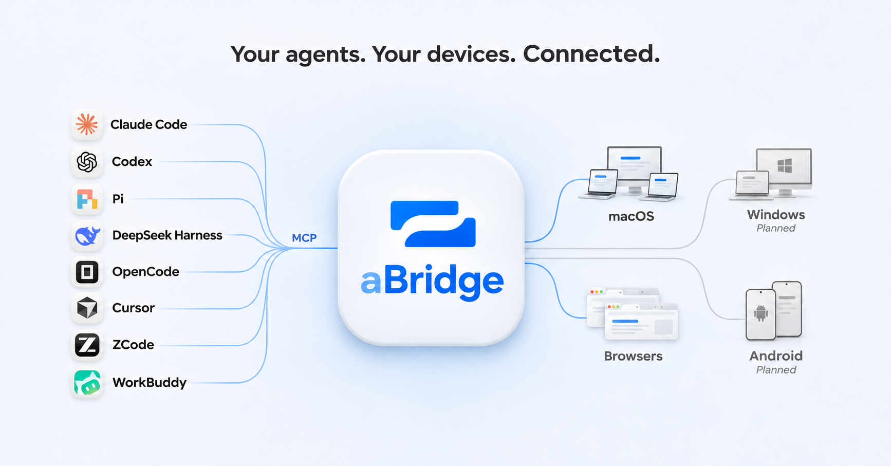

<p align="left">&nbsp;&nbsp;</p>

通过 MCP，让 Agent 使用你授权的电脑和浏览器。

| 客户端                  | 能力                       | 运行环境                   |
| ----------------------- | -------------------------- | -------------------------- |
| **aBridge App**         | 屏幕、键鼠、Shell、文件    | Apple Silicon，macOS 14+   |
| **aBridge for Browser** | 网页观察、导航、点击和填充 | Chromium 扩展，Chrome 116+ |

两种客户端独立注册为设备并连接 Server。浏览器扩展复用当前 Profile 的网站登录态，不依赖 App。Server、桌面运行时、扩展和管理台统一使用 TypeScript，macOS 界面由 Swift 提供。

当前为 **0.3 开发候选版本**。本仓库尚未发布可直接安装的公共 npm 包、公证 App 或扩展商店版本；源码和本地分发包的运行方式见下文。

## 启动 Server

需要 Node.js 26.7.0–26.x 与 npm。在仓库根目录运行：

```sh
npm ci
npm run build
npm start -- --web
```

CLI 默认启动 Server，`--web` 打开已构建的管理台，不启动前端开发服务器。空数据库首次启动时，仅回环访问可以用一次性配置链接创建管理账户。之后使用管理账户登录，在管理台维护设备和 Agent 授权。

默认监听 `127.0.0.1:8765`。状态目录、数据库、反向代理与无图形环境的配置见 [安装与维护](docs/deployment.md)。Server 使用 Node 内置 SQLite；其 API 当前仍为 Release Candidate，具体约束见 [架构](docs/architecture.md)。

## 安装客户端

### 浏览器扩展

先执行 `npm run build`，在 `chrome://extensions` 开启开发者模式，加载输出的 `dist/browser/`。源目录中的 TypeScript 需要构建后使用。

点击扩展图标，在设置中填写 Server 地址、管理账户和浏览器名称，完成一次绑定。每个 Profile 中的扩展安装实例是独立设备；在管理台把它加入 Agent 授权并选择 `browser` 能力。

工具栏面板提供状态、暂停/恢复、停止和设置。浏览器退出时设备离线，重新打开后自动重连；扩展不能自行启动已退出的浏览器。设备授权持久保存，网站登录仍受站点会话规则限制。详见 [浏览器客户端](docs/browser-profile-design.md)。

### macOS App

构建安装需要受支持的 Node.js、npm 和 Xcode Command Line Tools：

```sh
npm run build
npm run desktop:install
open "$HOME/Applications/aBridge.app"
```

安装器把 Node、已构建 CLI 和桌面依赖复制到当前用户的独立运行目录。Swift App 启动该 Node CLI；Cua 官方 Node SDK 仅在桌面进程中按需加载，Server 不需要原生驱动。运行时不依赖源码目录。

在管理台添加电脑设备，将 Device Key 填入 App，启用所需能力。屏幕与键鼠操作还需为实际安装的 App 授予 macOS 屏幕录制和辅助功能权限。系统权限、截图和输入效果须在该 App 环境中验证，不能用构建或替身测试代替。详见 [安装与维护](docs/deployment.md)。

## MCP 接入

在管理台创建 Agent Key，选择它可访问的设备、能力和期限。将以下信息填入支持 Streamable HTTP 的 MCP 客户端：

```json
{
  "url": "http://127.0.0.1:8765/mcp",
  "headers": { "Authorization": "Bearer <AGENT_KEY>" }
}
```

按 `devices_list` → `session_open` → 工具操作 → `session_close` 使用。Device Key 用于设备连接，Agent Key 用于 MCP 调用，两者不可互换。设备类型、授权、本机开关、系统权限和连接状态共同决定有效能力。

| 范围       | 工具                                                                                     |
| ---------- | ---------------------------------------------------------------------------------------- |
| 设备与会话 | `devices_list`、`device_get`、`session_open`、`session_close`                            |
| 桌面       | `computer_open`、`computer_apps`、`computer_windows`、`computer_observe`、`computer_act` |
| 浏览器     | `browser_open`、`browser_observe`、`browser_act`                                         |
| Shell      | `command_execute`、`command_status`、`command_cancel`                                    |
| 文件       | `files_list`、`file_read`、`file_write`                                                  |

导航和动作返回下一步可使用的观察；短命令直接返回输出，长命令才需继续等待。接口时效、分页和失败语义见 [架构与执行契约](docs/architecture.md)。

## 开发

```sh
npm run check
```

开发、提交和验证要求见 [贡献指南](.github/CONTRIBUTING.md)。

- [架构与执行契约](docs/architecture.md)
- [安装与维护](docs/deployment.md)
- [设计与资产](docs/design.md)
- [安全边界](.github/SECURITY.md)
- [变更记录](docs/changelog.md) · [第三方许可](docs/third-party-notices.md)

项目使用 [Apache-2.0](LICENSE)。tag 发布、npm Trusted Publisher 和 macOS 构建见[发布说明](docs/releasing.md)。
